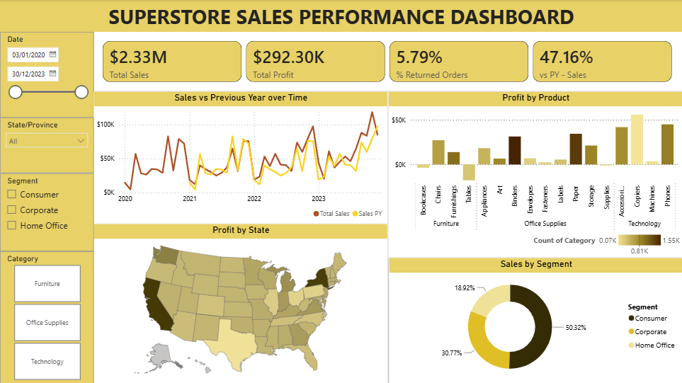

# Superstore Sales Analysis (2020–2023)

## Project Overview

This project analyzes retail sales performance from 2020 to 2023 using Power BI. The analysis explores sales, profitability, customer segments and returned orders to understand business performance and identify opportunities for improvement.

Through interactive data visualizations, the project transforms raw retail data into meaningful business insights that can support informed decision-making.

## Business Problem

Retail businesses need to understand how their sales activities contribute to overall profitability and business performance.

Without proper analysis, it can be difficult to identify profitable customer segments, monitor sales performance and understand the impact of returned orders.

This project uses historical retail data to examine key business performance indicators and provide insights that can support better business decisions.

## Project Objectives

- Analyze overall sales and profitability.
- Evaluate sales performance across customer segments.
- Examine the distribution of sales and profit.
- Analyze returned orders and their proportion of total orders.
- Identify business performance patterns and opportunities.
- Present findings through an interactive Power BI dashboard.

## Tools Used

- Power BI – Data visualization, dashboard development and analysis.
- Microsoft Excel – Data preparation and organization, where applicable.

## Key Performance Indicators (KPIs)

The analysis focuses on the following business metrics:

| Metric | Result |
|---|---:|
| Total Sales | $2.33M |
| Total Profit | $292.30K |
| Returned Orders | 5.79% |
| Consumer Segment | 50.32% |
| Corporate Segment | 30.77% |
| Home Office Segment | 18.92% |

## Analysis Areas

The project explores:

- **Sales Performance:** Evaluation of overall sales across the analysis period.
- **Profitability:** Examination of business profit performance.
- **Customer Segmentation:** Comparison of Consumer, Corporate and Home Office segments.
- **Returns Analysis:** Assessment of returned orders as a percentage of total orders.
- **Business Performance:** Exploration of key indicators to understand overall retail performance.

## Dashboard Preview

## Dashboard Preview

The interactive dashboard provides an overview of retail business performance from 2020 to 2023, focusing on sales, profitability, customer segments and returned orders.

It includes key performance indicators and visualizations that help explore sales trends, evaluate customer segment contributions, monitor profitability and understand product return patterns.

## Key Insights

- The business recorded total sales of $2.33 million and total profit of $292.30 thousand during the analysis period.
- The Consumer segment contributed the largest share of sales at 50.32%.
- The Corporate segment accounted for 30.77% of sales.
- The Home Office segment contributed 18.92% of sales.
- Returned orders represented 5.79% of total orders, highlighting an area worth monitoring.

## Recommendations

Based on the analysis, the following recommendations are proposed:

- **Customer Segment Strategy:** Continue evaluating the Consumer segment while identifying opportunities to grow Corporate and Home Office sales.
- **Profitability Monitoring:** Monitor profit performance alongside sales to ensure business growth translates into sustainable profitability.
- **Returns Management:** Investigate the reasons behind returned orders and identify opportunities to reduce avoidable returns.
- **Performance Tracking:** Regularly monitor sales and profitability indicators to identify changes in business performance.
- **Data-Driven Planning:** Use interactive dashboards to support business planning and informed decision-making.

## Conclusion

The Superstore Sales Analysis project demonstrates how data analytics and visualization can help businesses evaluate sales performance, understand customer segments and monitor profitability.

Using Power BI, the project transforms retail data into meaningful visual insights, highlighting key performance indicators such as total sales, profit and returned orders.

The findings demonstrate the importance of using data to understand business performance, identify opportunities and support informed strategic decisions.

## Project Files

Project datasets, Power BI dashboard files and supporting screenshots will be organized in their respective folders.

## Author

**Stella Gendo**

Data Analytics | Business Intelligence

---

*Turning retail data into meaningful business insights.*
